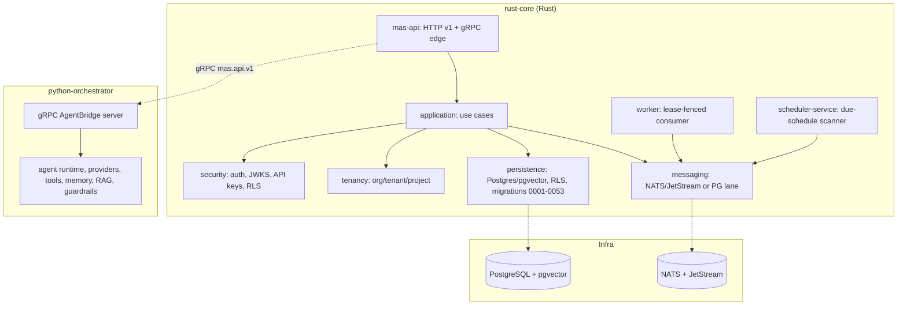

# enterprise-mas — Enterprise Multi-Agent System

Enterprise-grade multi-agent platform: a Rust core (`enterprise-mas/rust-core`)
that owns identity, tenancy, authorization, policy, quota, execution state,
audit, and persistence, plus a Python AI orchestrator
(`enterprise-mas/python-orchestrator`) that owns AI execution only, reached
through a versioned gRPC `AgentBridgeApi` contract.

> This is **source code**, not a SaaS. Shipped under a proprietary commercial
> source license (see `LICENSE` — TEMPLATE, have a lawyer review before sale).
> Nothing here is certified (no SOC2/ISO claims) and nothing is implied beyond
> what the code enforces.

## Architecture (mermaid)



## What it is

* **Rust core** — the authoritative control plane: tenant scope, authorization,
  policy, quota, execution/task state, audit, persistence (PostgreSQL/pgvector
  with RLS), messaging (NATS JetStream or Postgres polling lane), worker and
  scheduler processes, Axum HTTP v1 + tonic gRPC edge.
* **Python orchestrator** — AI execution only: agent runtime, model-provider
  adapters, tools, memory, guardrails, RAG plane. Rust never imports provider
  SDKs; Python never reads or writes Rust-owned tables.
* **Contract between them** — versioned gRPC `mas.api.v1.AgentBridgeApi`
  (`crates/api/proto/mas/api/v1/mas.proto`), body-bound HMAC signatures +
  bearer service token.

## Feature list (implemented only — verified in code)

* Tenancy: organizations, tenants, projects, users, memberships
* Agents: register, get, list, versions, publish, rollback
* Workflows: create, get, graph, publish, disable, versions, rollback
* Executions: submit (idempotent), list, get, steps, start/pause/resume/cancel
* API keys: create, list, revoke, rotate (raw material once)
* Policies: CRUD, publish, rollback, dry-run evaluate
* Quotas & usage summary (tenant-scoped reads)
* Analytics: overview, performance, tasks-by-agent, usage-cost, insights
* Audit events (keyset-paginated, redacted)
* Connectors & webhooks: register, probe, enable/disable, deliveries, replay
* OAuth authorization callback + connector-bound authorize
* Inbound webhook endpoints (public HMAC-verified ingestion)
* Tools: register, get, list, update, agent tool-permissions
* SSE stream (`/v1/stream`), per-tenant/per-principal caps
* Governance: `/v1/auth/me`, `/v1/audit-events`, `/v1/policies`, `/v1/quotas`,
  `/v1/usage/summary`
* 53 additive migrations (0001–0053), migration runner with FNV-1a checksum
  ledger + advisory lock
* gRPC `mas.api.v1` services; health probes; graceful shutdown
* CI (`ci.yml`, `security.yml`), Docker images (hardened, non-root),
  Compose stack, Helm chart

## Not included (not in this codebase)

* Frontend / dashboard UI
* WhatsApp channel
* Stripe checkout

## Quickstart

```bash
# 1. Compose (Postgres/pgvector + NATS + migrate + api + worker + scheduler + orchestrator)
cp deploy/compose/.env.example .env   # fill operator secrets; never commit .env
docker compose -f deploy/compose/docker-compose.yml up -d

# 2. Verify
curl -s http://127.0.0.1:8080/v1/health/live
curl -s -H "Authorization: Bearer dev-token" http://127.0.0.1:8080/v1/auth/me

# 3. Rust checks (from enterprise-mas/rust-core)
cargo fmt --all -- --check
cargo clippy --workspace --all-targets --locked -- -D warnings
cargo test --workspace --locked        # 1148 passed, 0 failed
cargo deny check

# 4. Python checks (from enterprise-mas/python-orchestrator)
bash scripts/bootstrap.sh
bash scripts/check.sh                  # 2003 passed, 2 skipped, 0 failed
```

## Repo map

```
.
├── LICENSE                      # proprietary commercial source (TEMPLATE)
├── README.md                    # this file
├── SECURITY.md                  # vulnerability reporting + enforced properties
├── CHANGELOG.md                 # keep-a-changelog; 1.0.0 from migrations 0001-0053
├── THIRD_PARTY_NOTICES.md       # generated from real dependency metadata
├── .gitignore
├── scripts/
│   ├── repo-cleanup.sh          # idempotent, dry-run by default
│   └── gen-third-party-notices.sh
├── .github/workflows/
│   ├── ci.yml                   # rust, bridge-e2e, python, openapi-parity, docker-build, compose-smoke
│   └── security.yml             # deny, audit, pip-audit, gitleaks, trivy
├── deploy/
│   ├── docker/*.Dockerfile      # api, worker, scheduler, migrate, orchestrator (hardened)
│   ├── compose/                 # docker-compose.yml, .env.example, nats.conf
│   └── helm/enterprise-mas/     # Chart, values, templates (default-deny network policy, hardened)
├── enterprise-mas/
│   ├── ci-evidence/             # raw logs: fmt, clippy, test, nats, bridge-e2e, deny, python check
│   ├── scripts/
│   │   ├── e2e-smoke.sh
│   │   └── gen-postman.py
│   ├── docs/
│   │   ├── ARCHITECTURE.md
│   │   ├── QUICKSTART.md
│   │   ├── DEPLOYMENT.md
│   │   ├── SECURITY_MODEL.md
│   │   └── postman/mas.postman_collection.json
│   ├── python-orchestrator/     # Python AI orchestrator (with its own README)
│   └── rust-core/               # Rust workspace (with its own README)
```

## Verified test counts (from ci-evidence logs)

| Command | Result |
|---------|--------|
| `cargo fmt --all -- --check` | PASS |
| `cargo clippy --workspace --all-targets --locked -- -D warnings` | PASS |
| `cargo test --workspace --locked` | 1148 passed, 0 failed |
| `cargo test --workspace --locked --features nats` | 1148 passed, 0 failed |
| `cargo test -p mas-ai-bridge --test e2e_python -- --ignored` | 12 passed, 0 failed |
| `cargo deny check` | PASS |
| `python-orchestrator/scripts/check.sh` | 2003 passed, 2 skipped, 0 failed |

Live-PostgreSQL / NATS-dependent suites and the compose smoke test could not
run in this environment (no postgres/pgvector, nats-server, or docker daemon;
no root to install them) and are listed under `ci-evidence/NOT_RUN.txt` with
the real error text.

## Releases

Tagged releases cut from `main`. Each release includes the committed
`Cargo.lock` (`--locked` builds in CI) and the generated
`THIRD_PARTY_NOTICES.md`.
